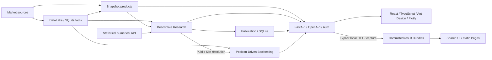

# Market State Lab

**Personal Research & Engineering Portfolio · 个人软件工程与金融研究作品**

将市场事实、描述性研究和持仓回测连接成可复核的工作流：Python Producer 负责计算与证据，FastAPI 发布契约，React / Plotly 展示正式结果。

**[Live Demo](https://ougachakaaa.github.io/hg-market-state-lab/)** · **[Source Code](https://github.com/ougachakaaa/hg-market-state-lab)**

Demo 已实现为匿名、只读的 GitHub Pages 站点：复用正式 React Presentation，展示已提交且经过校验的 HTTP 结果 Bundle，不在浏览器中获取实时行情或执行研究。
当前源码包含九个 Bundle、十个页面；[本地交付与历史发布证据](ui_web/demo/build/HANDOFF.md#current-delivery-and-historical-evidence) 分别记录对应范围，不能据此推定线上部署与当前分支一致。数据与展示边界见 [Demo authority](ui_web/demo/ARCHITECTURE.md)。

## 当前能力与架构

| 能力 | 当前交付 | 实现与验证入口 |
| --- | --- | --- |
| Data | 四个 Tushare Dataset（日历、指数、股指期货、期权）的 SQLite 缓存与 Coverage；MO Option Chain、Premium Plane 等确定性 Snapshot 产品。 | [Dataset 目录](data_lake/DATASETS.md)、[Snapshot 目录](data_snapshot/CAPABILITIES.md) |
| Research | Futures Basis 六节报告及在线执行；Calendar Spread 日常数据与历史相对价值；Trailing Return Observation / Batch / Publication；Price Segmentation Python case。 | [模块边界](market_research/ARCHITECTURE.md)、[使用入口](market_research/USAGE.md)、[能力证据映射](docs/recruiter-readiness-phase-1.md#capability-evidence) |
| Statistics | 独立 Python 数值 API：Quantile、IntervalCount、Mean、EmpiricalPercentile。 | [公共 API 与示例](market_statistics/README.md)、[方法契约](market_statistics/ARCHITECTURE.md) |
| Backtesting | Position-Driven Core 与 Futures Roll Long；M1/Q1 策略、PnL / Benchmark / Drawdown、Trades / Rolls 与 Evidence。 | [Core 与 case](market_backtesting/ARCHITECTURE.md)、[交付状态与限制](market_backtesting/cases/futures_roll_long/ROADMAP.md) |
| Delivery | FastAPI、OpenAPI / generated TypeScript、账户审批与认证；Web 页面；独立 SQLite Run / Publication Store；共享 Presentation 的静态只读组合。 | [HTTP 目录](ui_http/HTTP_PRODUCTS.md)、[Web 导航](ui_web/workspace.md)、[存储验收范围](market_research/STORAGE_RECONCILIATION.md#current-storage-status) |

以上区分代码中已实现的能力与各记录中的验收范围；本次文档审阅未重新执行这些业务验收。[Phase 1 审计记录](docs/recruiter-readiness-phase-1.md) 提供源码、代表性测试与未验证事项的对应关系。



箭头表示授权的数据流。业务模块只通过公开边界交互；浏览器不重算金融结果。仓库使用唯一根 Poetry / Python 环境，前端是独立 npm 项目。完整边界见 [ARCHITECTURE.md](ARCHITECTURE.md)。

完整 Web 包含 Research、Daily Data、Backtesting 总览及业务页面；使用登录、显式执行和服务端 Run。静态 Demo 只阅读捕获结果。项目尚未正式投产，文档中的 Production Web 指完整应用模式。Demo 保留真实来源说明和投资免责声明；第三方许可未核验，不表示提供方授权。

## 本地启动

需要 Python 3.13、Poetry、Node.js 20.19+ 或 22.12+、npm。复制根 `.env.example` 为 `.env`；真实行情获取需配置 `TUSHARE_TOKEN`，凭证不进入 Git。初始化和运行方式见 [DEVELOPMENT.md](DEVELOPMENT.md)。

```bash
# Linux / WSL，首次启动自动准备项目依赖
bash scripts/market-lab.sh start
# Windows：.\market-lab.cmd start
```

打开 `http://127.0.0.1:5173/`。本地 Production Web 使用登录；首次注册后从仓库根审批：

```bash
poetry run lab auth pending
poetry run lab auth approve <user-id>
```

公共静态构建仅消费已提交的独立结果包，不获取行情、不运行 Producer：

```bash
cd ui_web
npm ci
npm run demo:build
npm run demo:preview
```

## 测试与发布

普通开发仅验证直接改动的行为，文档修改做语义与 diff 审查；完整回归、浏览器矩阵及部署检查不作为固定清单。执行政策与手动检查入口见 [DEVELOPMENT](DEVELOPMENT.md#verification-policy)。示例：

```bash
poetry run pytest market_statistics/tests/test_public_api.py::test_quantile_example -q
cd ui_web
npm test -- src/app/routes.test.tsx
```

普通 push/PR 的 [Scoped development checks](.github/workflows/demo-compatibility.yml) 只检查变更源码与凭证；全量回归属于手动 workflow。CI 绿灯不代表全部测试通过，也不代表已部署。

正式发布由 Agent 审查指定来源、验收候选并快进 `main`，再由 `npm run demo:publish` 将准确的 remote-main SHA 推进 `release/demo-pages`，经 Actions 构建、Pages 部署和线上验收。已有部署的验收恢复使用 `npm run demo:verify-release -- --run <run-id>`，不重新发布。完整步骤见 [Release Runbook](ui_web/demo/release/RUNBOOK.md)，命令与前置要求见 [发布速查](ui_web/deploy/README.md#verified-demo-pages-release-ddb-06)。

## 限制与许可

- 无真实交易执行、订单撮合或实盘账户连接；回测不包含真实费用与滑点，不代表真实交易表现。
- 静态 Demo 使用固定历史窗口，不能查询实时行情或执行在线研究；完整本地 Web 的显式执行可访问 Provider 并写入缓存。
- Research Publication 的 HTTP 验证有 4 MiB 预算；较大 Source 的本地 Reader 成功不代表 HTTP 详细读取可用。
- `market_modeling` 仅预留，尚无模型实现；当前运行方式是单进程和本地 SQLite。
- Price Segmentation 尚无 HTTP/Web consumer；Conditional Research 未实现。真实数据验收只适用于记录的标的、窗口和环境；存储的原生非 WSL Linux 验收仍未运行，详见 [存储风险与未验证项](market_research/STORAGE_RECONCILIATION.md#remaining-known-risks-and-unverified-claims)。
- 本项目仅用于个人软件工程与金融研究方法展示。历史数据及研究结果不保证准确性、完整性或时效性，不构成投资建议。展示的回测结果不代表真实交易表现。

This project is a personal software engineering and financial research portfolio. Historical data and research results are provided for demonstration only, without warranties of accuracy, completeness or timeliness. Nothing constitutes investment advice. Backtested performance does not represent live trading results.

代码采用 **[AGPL-3.0](LICENSE)**。第三方市场数据不因仓库代码开源而自动获得再分发许可。
