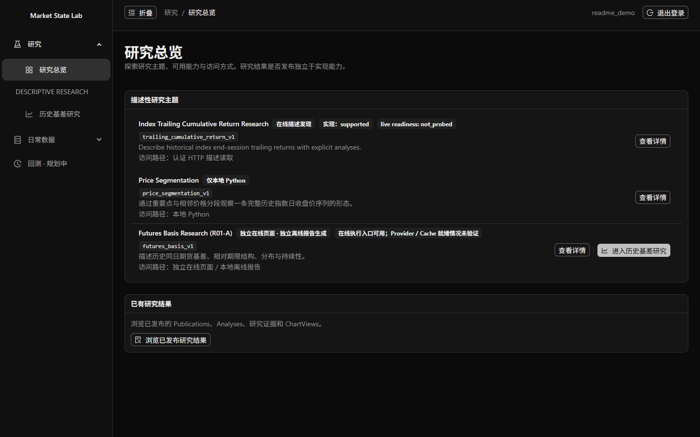
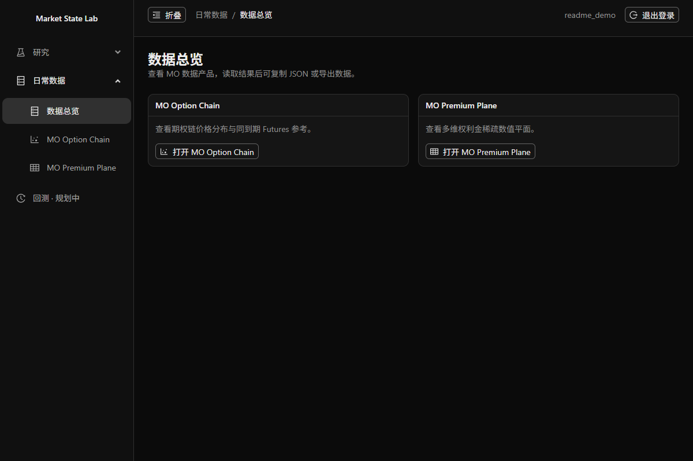
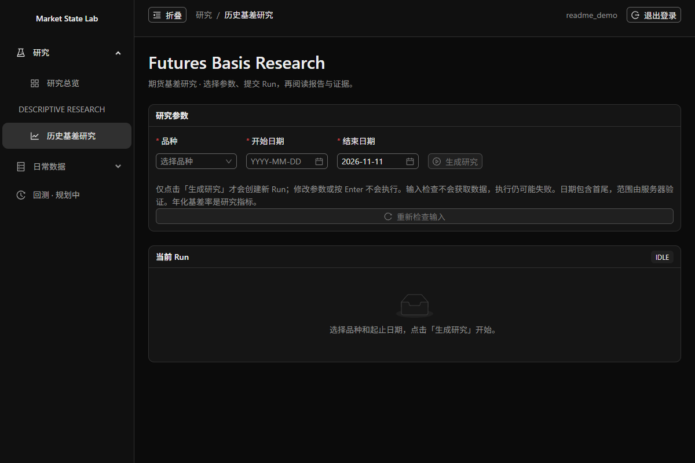
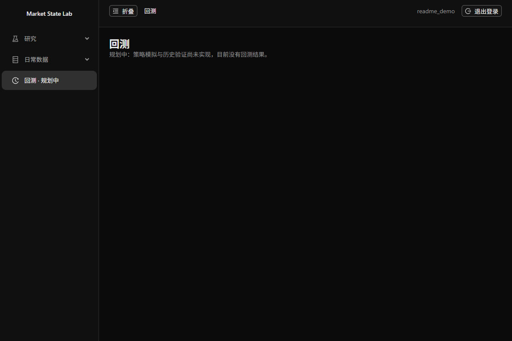
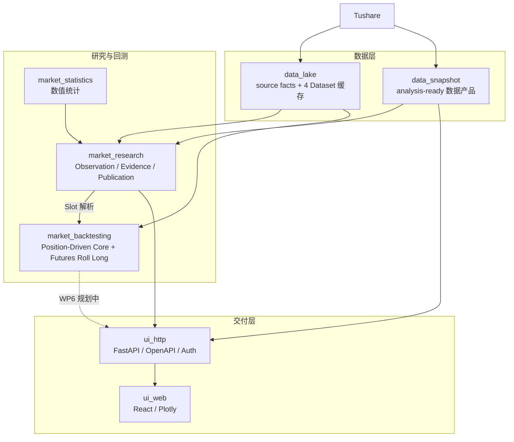

# Market State Lab

**可复现的市场数据与量化研究平台**

Market State Lab 把 Tushare 市场数据整理成可缓存、可验证的数据产品，并在其上完成描述性研究与策略回测。目标是让同一份市场事实、研究过程和策略结果都能被复核、导出和重新执行。

当前：数据与 MO 数据页、描述性研究、Futures Basis 已可用；回测 Python API 已可用，但 HTTP / Web 回测仍在开发中。

[快速启动](#如何启动) · [三部分能力](#三部分能力) · [项目演化](#项目演化) · [架构与关键模块](#架构与关键模块) · [详细说明](#详细说明) · [在线演示（规划中）](#项目状态与-roadmap)



*Research Workspace：研究总览入口，集中展示在线能力、Python case 与已发布结果。截图来自本地开发环境。*

## 如何启动

需要 Python 3.13、Poetry、Node.js 20.19+ 或 22.12+、npm；真实行情获取需要 `TUSHARE_TOKEN`。把根目录 `.env.example` 复制为 `.env`，填入 Token。首次启动或依赖不完整时，启动器会安装项目依赖，需要网络。

Windows：

```powershell
.\market-lab.cmd start
```

Linux / WSL：

```bash
bash scripts/market-lab.sh start
```

启动后打开 `http://127.0.0.1:5173`，登录进入 `/research` 工作台，回测页面位于 `/backtesting`。首次注册后，在仓库根目录审批：

```bash
poetry run lab auth pending
poetry run lab auth approve <user-id>
```

同一启动器的 `status` / `stop` 子命令可查看状态或停止服务。完整配置、依赖安装与平台限制见 [DEVELOPMENT.md](DEVELOPMENT.md) 和 [运行限制](#运行限制)。

## 三部分能力

| 数据 | 研究 | 回测 |
| --- | --- | --- |
| [](docs/assets/capability-data.png) | [](docs/assets/capability-research.png) | [](docs/assets/capability-backtesting.png) |
| 已可用 | 已可用 | Python API 已可用；Web 规划中 |
| 4 个 Tushare Dataset（日历 / 指数 / 期货 / 期权）；Snapshot 提供指数日线、历史基差与 MO 数据产品。 | Futures Basis（Web / HTTP）；Trailing Return（Python / HTTP，Web 仅发现）；Price Segmentation（仅 Python）；统计与 Publication。 | Position-Driven Core + Futures Roll Long；Policy → Replay → Accounting → Result；PnL / Benchmark / Drawdown / Evidence。 |
| [DataLake](data_lake/ARCHITECTURE.md)、[Snapshot](data_snapshot/CAPABILITIES.md) | [Research](market_research/ARCHITECTURE.md)、[Statistics](market_statistics/ARCHITECTURE.md) | [Backtesting](market_backtesting/ARCHITECTURE.md)、[Roadmap](market_backtesting/cases/futures_roll_long/ROADMAP.md) |

三张截图均为真实页面；回测 Web 尚未完成，`/backtesting` 截图只展示当前规划状态，不包含伪造结果；数据页截图不包含行情数值。

## 项目演化

1. **先解决数据**：最初只是为了在用 GPT 讨论市场时有一份可靠、可复现的数据：关键数据不准确、口径不一致、衍生指标不可验证，都让分析无法复核。事实来自 Source，指标按明确规则计算；GPT 只使用结果，不作为事实来源，项目也没有集成 GPT API。
2. **再解决研究**：每日数据不够，逐步加入历史数据复用、描述性统计、基差与期限结构、收益分布和价格序列分段；数据、统计与研究语义因此拆成独立模块。
3. **最后进入回测**：统计规律不等于可执行策略，于是加入 Position-Driven Backtesting Core 与第一个 case（Futures Roll Long），区分策略目标、Replay、Accounting、Performance 与 Result / Evidence。

**Reliable Market Data → Reproducible Research → Strategy Validation**

**最终期望**：一个数据、研究、回测都能被复核和重新执行的研究平台；当前缺口是回测 HTTP / Web、真实市场 E2E 与静态 Demo。

## 架构与关键模块



| 模块 | 一句话职责 |
| --- | --- |
| `data_lake` | 4 个 Tushare Dataset、SQLite 缓存与 public Application Service。 |
| `data_snapshot` | 确定性 preparation 与 analysis-ready 数据产品；不拥有研究解释。 |
| `market_research` | observation、样本转换、统计关联、Evidence 与 Publication。 |
| `market_statistics` | Quantile / IntervalCount / Mean；不获取市场数据。 |
| `market_backtesting` | Position-Driven Core + Futures Roll Long；当前 Python API。 |
| `ui_cli` | `lab` 命令路由与 delegation。 |
| `ui_http` | FastAPI、DTO、OpenAPI 与 Auth。 |
| `ui_web` | React / Plotly 展示；不重算金融结果。 |
| `market_modeling` | Reserved；没有 module authority 或实现。 |

图中箭头表示数据 / 授权语义流向，不是完整的 Python import 图；例如 `ui_http` 实际依赖 owning module 的 public boundary。详细边界见 [ARCHITECTURE.md](ARCHITECTURE.md)。

---

## 详细说明

### 能力与状态

| 能力 | 当前入口 | 状态 |
| --- | --- | --- |
| DataLake 与本地缓存 | `poetry run lab datalake list` / `coverage` / `ensure` / `export` | 已可用 |
| Snapshot 数据产品 | Python；MO 产品另有 HTTP / Web | 已可用 |
| Trailing Return | Python；HTTP `/research/capabilities`、`/research/preview`、`/research/execute` | 已可用；Web 仅做能力发现 |
| Price Segmentation | Python | 仅 Python |
| Futures Basis Research | Web `/research/futures-basis`；HTTP；Python；离线报告 | 已可用；原生 Windows 在线 503 |
| Research Publication / Explorer | Python `retain_source` / `publish`；Web / HTTP 只读 | 已可用 |
| 通用数值统计 | `market_statistics` Python API | 仅 Python |
| Position-Driven Core + Futures Roll Long | `market_backtesting` Python API | 仅 Python |
| Backtesting HTTP / Web | WP6 / WP7 | 规划中 |
| Daily Data Copy / Export | MO 页面的 Copy Raw JSON / Context JSON、CSV / Context JSON Export | 已可用 |
| CLI / OpenAPI | `lab`；FastAPI / OpenAPI | 已可用 |

Research 的 execute / submit 不是纯预览：`POST /research/execute` 与 Futures Basis Run 提交都可能触发 DataLake ensure 与 Tushare 请求，并写入正常 Dataset cache；请先完成 capability / preflight 检查，再显式授权执行。

### 典型研究案例

**案例一：股指期货历史基差研究（R01-A）**

- **问题**：同一交易日，股指期货相对标的指数的基差处于什么水平？不同期限的期限结构如何变化？分布的折价 / 升水持续性如何？
- **输入**：一个明确品种（IM / IC / IF / IH）与包含首尾的日期区间；CFFEX / SSE 日历、期货日线、指数日线。
- **结果**：六段式报告——Overview、Historical Basis、Distributions、Term Structure、Discount Persistence、Evidence and Limitations；基差是描述性指标，不是预测或交易信号。
- **入口**：Web `/research/futures-basis`；HTTP preflight / submit / status / report；离线 HTML 报告；Python case API。原生 Windows 在线 run store 返回 503，完整路径使用 Linux / WSL。

契约见 [Futures Basis case](market_research/descriptive/cases/futures_basis/ARCHITECTURE.md) 与 [offline delivery](market_research/descriptive/cases/futures_basis/DELIVERY.md)。

**案例二：股指期货展期持有策略回测（Futures Roll Long）**

- **问题**：只做多一手真实股指期货合约，在最后交易日按固定规则展期、窗口末平仓，其历史毛收益与风险特征与同期指数买入持有相比如何？
- **输入**：品种、日期区间、策略 profile（`expiry_to_M1_v1` / `expiry_to_Q1_v1`）；CFFEX 日历、期货日线（含真实到期日与乘数）、指数日线。
- **结果**：逐日 PnL / equity / benchmark / drawdown、trades、rolls、summary、evidence 与 V2 Views；evidence package 可离线复现。
- **入口**：Web `/backtesting`（参数 → Preflight → 显式提交 → Run 状态 → 结果阅读）；HTTP preflight / submit / status / result；Python API。原生 Windows 缺少所需 POSIX 运行能力，完整在线工作流在 Linux / WSL 中执行。

```python
from datetime import date

from market_backtesting.cases.futures_roll_long import (
    FuturesRollRequest,
    build_backtest_result,
    create_futures_roll_service,
)

execution = create_futures_roll_service().run(
    FuturesRollRequest(
        product_code="IM",
        start_date=date(2025, 2, 17),
        end_date=date(2025, 3, 24),
        strategy_profile="expiry_to_M1_v1",
    )
)
result = build_backtest_result(execution)
print(result.summary.total_pnl, result.evidence.input_fingerprint)
```

该调用可能触发 DataLake ensure 与 Tushare 请求；只在明确授权、缓存与账户权限就绪时运行。示例日期不是研究默认窗口，也不代表历史结论。

完整窗口（2024-01-01 → 2026-10-30）的真实 IM 验收、HTTP worker 执行与 Windows Chrome → WSL 浏览器证据见 [WP8 acceptance](market_backtesting/cases/futures_roll_long/WP8_ACCEPTANCE.md)。Backtesting 不是 Research capability、Publication 或 Workbench Run。

### 为什么这样分模块

- **数据口径与研究语义分开**：`data_lake` 只拥有 source facts 与缓存，`data_snapshot` 只做 analysis-ready 产品；基差、收益率与样本合法性由 owning module 定义，统计库只计算数值。
- **研究与策略分开**：Research 产出 evidence 与 finding，不自动变成策略；Backtesting 只消费明确授权的数据与 Slot 解析边界。
- **计算与展示分开**：`ui_http` 只做 transport，`ui_web` 只做 rendering；PnL、收益、benchmark 与 drawdown 不在浏览器重算。
- **失败与证据分开**：数据、研究与回测各自拥有 failure classification、fingerprint 与 evidence；缺数据不会静默变成零或成功。

### 技术栈与选型

| 技术 | 使用位置 | 承担的职责 | 为什么适合 / 主要边界 |
| --- | --- | --- | --- |
| **Python 3.13 + Poetry** | 全仓库 | 统一 runtime、依赖解析与 lock | 金融数据与研究生态成熟；单一 `.venv` / lock 保证可复现；模块不建独立环境。 |
| **Pandas / NumPy** | Pandas：Tushare provider、Snapshot Capture；NumPy：Statistics | 表格 / 时间序列处理；数值计算后端 | 数据边界用 Pandas，统计用 NumPy；不把业务语义藏进 DataFrame。 |
| **SQLite** | DataLake Dataset cache；Auth | 本地 source-fact 缓存；用户与审批存储 | 嵌入式、事务与外键完整、零运维；范围与限制见下。 |
| **FastAPI / Pydantic / OpenAPI** | `ui_http` | HTTP application、DTO 校验、OpenAPI | 类型化、轻量，契约可生成；业务语义仍在 owning module。 |
| **React / TypeScript / Vite** | `ui_web` | SPA、类型安全、独立构建 | 组件化适合多研究页面；TypeScript 约束 API 使用；Vite 提供快速 dev / build。 |
| **Ant Design / Plotly** | `ui_web` | 常规 UI 组件与交互图表 | 成熟组件覆盖研究工具；Plotly 支持 zoom / pan / hover；前端只渲染 producer 数据。 |
| **Pytest / Vitest / Playwright** | 全仓库 | Python、前端与真实浏览器测试 | 分层覆盖契约、组件与 Chromium 流程；浏览器验收不只做 mock。 |
| **Ruff / Mypy / Oxlint** | Python / frontend | lint 与静态类型检查 | Python 配置在仓库根，前端使用 `ui_web/.oxlintrc.json`；不引入 ESLint。 |
| **Argon2id / PyJWT** | `ui_http` Auth | 密码哈希、JWT 与 HttpOnly Cookie | 真实密码学基础；应用内限流已有，生产入口限流与部署加固未完成。 |
| **Tushare** | DataLake provider、Snapshot Capture | 当前市场数据 Source | 覆盖日历、指数、期货与期权；需要 token、权限与限流，不是无依赖公共源。 |

#### 为什么是 SQLite

SQLite 解决的是“本地研究缓存与认证存储”，不是整个系统的中心数据库。

| 存储 | 机制 | 用途 |
| --- | --- | --- |
| `data_lake/datasets/<dataset-id>/data/<dataset-id>.sqlite3` | 每个 Dataset 一个 SQLite | 4 个 Dataset 的 source-fact 缓存、frozen basis、逐 unit 事务与读快照 |
| `ui_http/data/auth.sqlite3`（或 `LAB_AUTH_DB_PATH`） | 独立 SQLite | 用户、审批状态与身份查询 |
| `data_snapshot/data/raw/` | JSON 文件 | Snapshot Raw Artifact |
| `LAB_RESEARCH_PUBLICATION_ROOT` 指定目录 | JSON + 原子 hard link | Research Publication 的 source、analysis、View 与 Manifest |
| `market_research/.runtime/futures_basis_online/`、`market_backtesting/.runtime/futures_roll_long_online/` | JSON 文件 | 在线运行状态与 reader / result 投影 |
| Research Observation / 统计结果 | 内存对象 | 未显式发布时不自动持久化 |

因此，**SQLite 只承担 DataLake 缓存与 Auth 存储**；研究发布、在线运行与回测结果使用文件存储，研究中间对象默认只在内存中。

选择 SQLite 的理由：

- 本地单用户、低频研究，通常只涉及少量 Dataset 或一个 Auth 库，不需要独立数据库服务。
- 嵌入式部署：`poetry install` 后即可使用，不需要安装、启动或配置 PostgreSQL 之类的服务。
- 每个 unit 的 success 提交是短事务并开启外键；读操作使用 committed snapshot，缓存有明确 lifecycle。
- cache 可重建；generation 不兼容时要求重建 owning Dataset，而不是自动迁移。
- 内容寻址的 frozen basis、输入 fingerprint 与完整 export 便于追溯实际消费的事实。

限制：

- 没有多进程 / 分布式协调；并发写入依赖 SQLite 自身锁，不适合高并发或多用户。
- 不做 in-place migration；不兼容 cache 需要显式重建。
- 需要原子发布与跨进程可见性的 Publication / online run store 使用 POSIX 文件存储，而不是 SQLite。
- 生产级多 worker、反向代理、入口限流与高可用部署仍未完成。

### 运行限制

- 一键启动需要默认端口 `8011`（backend）与 `5173`（Web）空闲；启动器不会终止占用端口的其他程序。
- 原生 Windows 缺少 Publication 与在线 run store 所需的 POSIX descriptor-relative 文件能力：Publication 读写与 Futures Basis 在线 run 返回 503，Research Explorer 显示 Publication 存储不可用。
- Backtesting 的 online store 同样要求 POSIX；当前原生 Windows 上不可用，且尚未暴露 HTTP。
- 完整的 Publication、在线回测与相关浏览器验收请在 Linux / WSL 中运行；Linux 启动器还检查 `flock`、`ss`、`ps`、`setsid`、`curl`、`awk`、`tr`。
- 本地已有的旧 Dataset cache 若不兼容，会明确失败并要求重建 owning Dataset；不会自动迁移或静默回退。
- Windows 上的其他页面可以正常启动；能否返回数据仍取决于 Tushare 权限、网络与本地 cache 是否兼容。

### 项目状态与 Roadmap

**已可使用**

- DataLake 4 个 Dataset 的发现、覆盖检查、补齐与导出；
- MO Option Chain / Premium Plane Web 与 HTTP；
- Trailing Return 的 Python / HTTP 研究；
- Price Segmentation 的 Python API；
- Futures Basis 的 Web / HTTP / Python / 离线报告；
- Publication 的 Python 发布与 Web / HTTP 只读浏览；
- Quantile / IntervalCount / Mean 统计 API；
- Futures Roll Long 的 Core、Python 执行、Result、Evidence 与 online application；
- 认证、`lab` CLI、OpenAPI 与契约校验。

**开发中**

- W2 WP6 Backtesting HTTP product；
- WP7 `/backtesting` Web 页面；
- WP8 真实市场端到端验收与 reconciliation。

**规划中**

- GitHub Pages 静态演示（当前没有公开在线地址，不以本地地址冒充 Demo）；
- `market_modeling`（Reserved，尚无 authority 或实现）；
- 生产部署加固（HTTPS、反向代理、可信代理链、入口限流、多进程）；
- 更多研究 case 与回测策略（需要新的语义决策与 authority）。

**明确不做**

- 自动交易、下单、broker / matching engine、实盘执行；
- 用 GPT 回答替代市场事实或自动 AI 投资决策；
- order-driven 交易框架、多策略 registry / plugin、优化器；
- 在 Web 端重算 PnL、收益、benchmark 或 drawdown；
- 把 W3 的费用、滑点、保证金、分红等能力描述成已完成。

### 文档导航

| 想了解 | 入口 |
| --- | --- |
| 仓库整体架构、Python runtime、模块边界与依赖方向 | [ARCHITECTURE.md](ARCHITECTURE.md) |
| 本地环境、启动器、Auth、配置与验证 | [DEVELOPMENT.md](DEVELOPMENT.md) |
| `lab` 命令、DataLake 操作与常见 workflow | [ui_cli/README.md](ui_cli/README.md) |
| DataLake 的 Dataset、public service 与缓存生命周期 | [data_lake/ARCHITECTURE.md](data_lake/ARCHITECTURE.md)、[DATASETS.md](data_lake/DATASETS.md) |
| Snapshot 产品与 analysis-ready 语义 | [data_snapshot/ARCHITECTURE.md](data_snapshot/ARCHITECTURE.md)、[CAPABILITIES.md](data_snapshot/CAPABILITIES.md) |
| Research 的 observation、execution 与 Publication | [market_research/ARCHITECTURE.md](market_research/ARCHITECTURE.md)、[USAGE.md](market_research/USAGE.md) |
| Backtesting 的 Core、case 与当前进度 | [market_backtesting/ARCHITECTURE.md](market_backtesting/ARCHITECTURE.md)、[W2 roadmap](market_backtesting/cases/futures_roll_long/ROADMAP.md) |
| 数值统计契约 | [market_statistics/ARCHITECTURE.md](market_statistics/ARCHITECTURE.md) |
| HTTP 产品与 OpenAPI 契约 | [ui_http/ARCHITECTURE.md](ui_http/ARCHITECTURE.md)、[HTTP product catalog](ui_http/HTTP_PRODUCTS.md) |
| Web 页面与前端 feature | [ui_web/ARCHITECTURE.md](ui_web/ARCHITECTURE.md)、[FEATURES.md](ui_web/FEATURES.md) |

README 只做用户说明与导航。字段、公式、null / zero、HTTP 与可视化语义，以对应 semantic authority 为准；README 不是新的 architecture authority。

---

仓库：[github.com/ougachakaaa/hg-market-state-lab](https://github.com/ougachakaaa/hg-market-state-lab)
