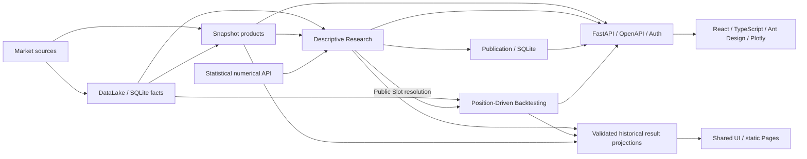

# Market State Lab

**Personal Research & Engineering Portfolio · 个人软件工程与金融研究作品**

将市场事实、描述性研究和持仓回测连接成可复核的工作流：Python Producer 负责计算与证据，FastAPI 发布契约，React / Plotly 展示正式结果。

**[Live Demo](https://ougachakaaa.github.io/hg-market-state-lab/)** · **[Source Code](https://github.com/ougachakaaa/hg-market-state-lab)**

Live Demo V2 已上线：七页面展示真实历史 MO 数据、IM 基差、M1/Q1 回测和 Trailing Return Publication。无需登录、Python 后端或 Token；只阅读预先计算的结果，不在线执行研究。[发布 SHA、CI、逐文件哈希与线上验收](ui_web/src/demo/D7_RELEASE_ACCEPTANCE.md)。



箭头表示授权的数据流。业务模块只通过公开边界交互；浏览器不重算金融结果。仓库使用唯一根 Poetry / Python 环境，前端是独立 npm 项目。完整边界见 [ARCHITECTURE.md](ARCHITECTURE.md)。

| 范围 | 已实现 |
| --- | --- |
| Data | 四个 Tushare Dataset：日历、指数、股指期货、期权；SQLite 缓存与可验证 Coverage；Snapshot 的 MO Option Chain、Premium Plane 等确定性产品。 |
| Research | Futures Basis 六节报告、期限结构与折价持续性；Trailing Return Observation / Batch / Publication；Price Segmentation Python case；Quantile / IntervalCount / Mean 独立数值 API。 |
| Backtesting | Position-Driven Core 与 Futures Roll Long；M1/Q1 策略、持仓 Replay、PnL / Benchmark / Drawdown、Trades / Rolls 与 Evidence。 |
| Delivery | FastAPI、generated OpenAPI / TypeScript、账户审批与认证；七个 Web 路由；独立 SQLite Run / Publication Store；正式 Presentation 的静态只读组合。 |

生产 Web 包含 Research Overview、Historical Basis、Research Explorer、Daily Data、MO Option Chain、MO Premium Plane 与 Futures Roll Long。真实数据公共结果按仓库所有者本次明确指示分发，来源标注保留；第三方许可未核验，不表示提供方授权。

## 本地启动

需要 Python 3.13、Poetry、Node.js 20.19+ 或 22.12+、npm。复制根 `.env.example` 为 `.env`；真实行情获取需配置 `TUSHARE_TOKEN`，凭证不进入 Git。初始化和运行方式见 [DEVELOPMENT.md](DEVELOPMENT.md)。

```bash
# Linux / WSL，首次启动自动准备项目依赖
bash scripts/market-lab.sh start
# Windows：.\market-lab.cmd start
```

打开 `http://127.0.0.1:5173/`。本地 Production Web 使用登录；首次注册后从仓库根审批：

```bash
poetry run lab auth pending
poetry run lab auth approve <user-id>
```

公共静态构建仅消费已提交的独立结果包，不获取行情、不运行 Producer：

```bash
cd ui_web
npm ci
npm run demo:build:public
# 输出 dist-demo-public/site，部署 base 为 /hg-market-state-lab/
node scripts/public_demo_browser.mjs
```

Private build 保持独立，其外部输入及使用方式见 [PRIVATE_BUILD.md](ui_web/src/demo/PRIVATE_BUILD.md)。

## 测试与发布

CI 分别执行 Research、Backtesting、DataLake、Snapshot、HTTP 与脚本 Python suites；前端执行全量 Vitest、契约 freshness、Production / V1 / V2 build、lint、路由穷尽性、静态依赖隔离、公共资产安全与 Chromium 验收。各 Python suite 从仓库根独立运行，避免同名测试模块收集冲突。

```bash
poetry run pytest market_research/tests -q
poetry run pytest market_backtesting/tests -q
cd ui_web
npm run contract:check
npm test
npm run build
npm run lint
npm run test:static-compatibility
npm run test:public-safety
```

正式发布沿 `develop → Release Review → main → GitHub Actions → Pages`。同 SHA 的完整兼容性、准入、实际资产扫描、文件 SHA-256 与浏览器检查必须通过，再经 `github-pages` Environment 部署。详见 [Public build](ui_web/src/demo/PUBLIC_BUILD.md) 与 [Release contract](ui_web/src/demo/RELEASE.md)。

## 限制与许可

- 无真实交易执行、订单撮合或实盘账户连接；回测不包含真实费用与滑点，不代表真实交易表现。
- 静态 Demo 使用固定历史窗口，不能查询实时行情或执行在线研究；完整本地 Web 的显式执行可访问 Provider 并写入缓存。
- Research Publication 的 HTTP 验证有 4 MiB 预算；较大 Source 的本地 Reader 成功不代表 HTTP 详细读取可用。
- `market_modeling` 仅预留，尚无模型实现；当前运行方式是单进程和本地 SQLite。
- 本项目仅用于个人软件工程与金融研究方法展示。历史数据及研究结果不保证准确性、完整性或时效性，不构成投资建议。展示的回测结果不代表真实交易表现。

This project is a personal software engineering and financial research portfolio. Historical data and research results are provided for demonstration only, without warranties of accuracy, completeness or timeliness. Nothing constitutes investment advice. Backtested performance does not represent live trading results.

代码采用 **[AGPL-3.0](LICENSE)**。第三方市场数据不因仓库代码开源而自动获得再分发许可。
